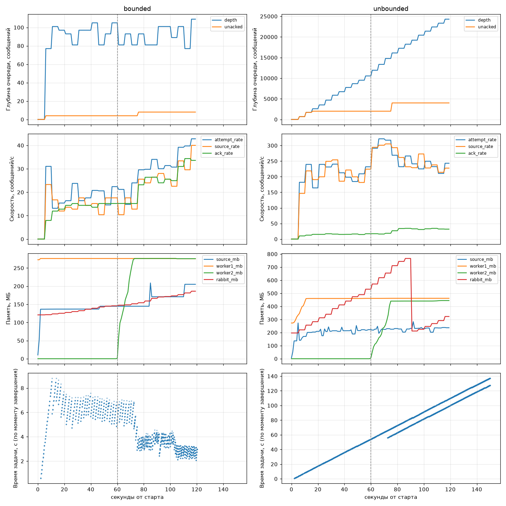

# scoring

Скоринг снимков Kaggriculture через RabbitMQ. Источник и `POST /api/v1/tasks` кладут задачи в ограниченную очередь, воркеры на FastStream считают вероятность победы моделью из MLflow и пишут результат в Postgres. Медленные воркеры сами задают темп источнику, а внешний клиент при перегрузке сразу получает 503.

Все три процесса пишут JSON-логи в stdout и отправляют трейсы и метрики по OTLP. Стек наблюдаемости (Vector, Loki, OTel Collector, Tempo, Prometheus, Grafana) включается профилями compose, подробности в разделе [Наблюдаемость](#наблюдаемость).

```
источник (реплеи) ──publish, ждёт confirm──┐
                                           ▼
POST /api/v1/tasks ──publish, ждёт confirm──> tasks: quorum, x-max-length=100, reject-publish
     │ nack → 503                           │ prefetch=4                │ после 3 возвратов
     ▼                                      ▼                           ▼
  Postgres <────── upsert по id ────── воркер ×N                  tasks.dlx → tasks.dlq
                                       модель @champion, 4 потока
```

Признаки и загрузку модели берём из соседнего проекта [`mlflow`](../mlflow/README.md), он подключён path-зависимостью. MLflow поднимается там же (`make up`), в реестре должна быть `kaggriculture-winprob@champion`.

## Запуск

Приложение работает в контейнерах. MLflow остаётся в своём стеке `../mlflow`: если включить его сюда, `docker compose down -v` сотрёт реестр вместе с моделью, и воркер не стартует. Воркер ходит к MLflow на опубликованный порт хоста через `extra_hosts: mlflow:host-gateway`, имя `mlflow` уже есть в `--allowed-hosts` сервера.

```bash
make install               # зависимости и .env; REPLAYS_DIR поправить, если реплеи не в ../mlflow/data
make up                    # api, worker, RabbitMQ (UI на :15672, guest/guest), Postgres
make observability         # то же плюс стек наблюдаемости, Grafana на :3000 (admin / GRAFANA_ADMIN_PASSWORD)
make load LIMIT=6000       # источник в контейнере
make scale WORKERS=2       # второй воркер
make poison                # заведомо некорректная задача
make test
```

`make api`, `make worker` и `make source` по-прежнему запускают процессы на хосте, на них работает эксперимент из конца README.

```bash
curl -i -X POST localhost:8000/api/v1/tasks -H 'content-type: application/json' -d @docs/observation.json
curl localhost:8000/api/v1/tasks/<id>
```

`POST /api/v1/tasks` заменил синхронный `/process`: отвечает `202` с `Location`, результат потом читается через `GET`.

Код в `src/scoring/`:

- `topology.py` — формат задачи, очередь, DLX, DLQ;
- `worker.py` — подписчик, пул потоков, `/healthz`;
- `source.py` — чтение реплеев и публикация с повтором;
- `api.py` — HTTP;
- `db.py` — таблица и upsert;
- `logs.py` — JSON-логи, task_id и trace_id в каждой записи;
- `telemetry.py` — настройка OpenTelemetry SDK;
- `poison.py` — отправка битой задачи для проверки DLQ;
- `experiment.py` — эксперимент из конца README.

Источник, воркеры и API — отдельные процессы, связаны только через RabbitMQ. Все параметры в `.env.example`. Длительность inference задаёт `INFERENCE_DELAY_S` (0.2 с).

Модель воркер грузит один раз при создании приложения. Alias превращается в номер версии, грузится эта версия, номер пишется в каждый результат. Так метаданные не разойдутся с весами, если alias переставят во время загрузки.

## Брокер → воркер

`PREFETCH_COUNT=4` и `WORKER_THREADS=4`. aio-pika запускает обработчик на каждое доставленное сообщение, значит prefetch и есть число задач, которые воркер держит одновременно. Параллельно они выполняются в пуле, поэтому prefetch равен размеру пула.

Задача занимает поток примерно на 0.27 с: 0.2 с задержки, около 30 мс на модель и запись в БД. Отсюда пропускная способность воркера 4 / 0.27 ≈ 15 задач/с, в эксперименте вышло 14.7.

Если сделать prefetch больше пула, лишние сообщения будут ждать внутри воркера. Брокер считает их выданными, второй воркер их не получит, растут память и время задачи, а при падении всё это вернётся в очередь. В эксперименте без лимита воркер набрал 2000 таких сообщений: это потолок quorum-очереди для prefetch 0. Его память выросла с 276 до 462 МБ, а остановка заняла 30 с. Если prefetch меньше пула, потоки простаивают.

Цена равенства — небольшой простой, пока поток пишет результат и ждёт следующее сообщение. Это 7–15% пропускной способности по сравнению с неограниченным prefetch. Можно взять пул + 1, но здесь важнее не держать буфер в воркере.

Event loop inference не блокирует: модель и `time.sleep` выполняются в `ThreadPoolExecutor` через `run_in_executor`. Под нагрузкой `/healthz` воркера отвечает за 1–2 мс, это же проверяет тест `test_inference_does_not_block_event_loop`.

`OMP_NUM_THREADS=1` стоит потому, что HistGradientBoosting запускает свои потоки OpenMP, и они конкурируют с пулом: 32 мс на вызов против 16.

## Воркер → источник

У очереди `x-max-length=100` и `x-overflow=reject-publish`, у публикаций включены publisher confirms. Когда очередь полна, брокер отвечает на публикацию `basic.nack`, в источнике это `DeliveryError`.

Получив отказ, источник ждёт и повторяет то же сообщение. Пауза удваивается от 10 мс до 1 с, со случайной частью, и сбрасывается после успеха. Следующее сообщение не отправляется, пока не подтверждено текущее, а реплеи читаются по одной партии. Поэтому задачи не теряются и не копятся в памяти: за 27 тысяч задач память источника не выросла.

Место в очереди освобождается с той скоростью, с какой воркеры подтверждают сообщения, и источник занимает его по мере освобождения. В итоге его скорость сама становится равна суммарной скорости воркеров, и второй воркер ускоряет источник без каких-либо настроек.

Пауза ограничена 1 с: при двух воркерах очередь из 100 задач уходит за 3.5 с, и за время паузы источника она не успеет опустеть.

Лимит quorum-очереди считает только готовые сообщения и пропускает одно сверх лимита. Поэтому в UI бывает до 101 + 4 × число воркеров.

Почему не другие способы:

| Способ | Почему нет |
|---|---|
| смотреть глубину через Management API | статистика обновляется раз в 5 с, между проверкой и публикацией очередь меняется, несколько источников гонятся; nack приходит на каждое сообщение сразу |
| `x-overflow=drop-head` | брокер выбрасывает старые задачи |
| memory alarm и flow control брокера | срабатывают на весь узел и блокируют всех публикаторов, включая API, которому нужно быстро ответить 503 |
| фиксированный rate limit источника | подбирается руками под число воркеров, второй воркер ничего не даст |
| воркер сам сообщает, сколько готов принять | то же, что prefetch и лимит очереди, только с отдельным обратным каналом |
| буфер в источнике | задачи копятся в памяти и теряются при падении |

## Граница системы

Клиента API замедлить нельзя, поэтому API не ждёт места в очереди. Он в одной транзакции вставляет строку `pending`, публикует задачу и ждёт confirm. На `ack` делает коммит и отвечает 202. На `nack` или ошибку брокера откатывает транзакцию и отвечает 503. После 503 в БД ничего не остаётся. Если воркер обработал задачу раньше коммита, его upsert подождёт на первичном ключе.

`Retry-After` — это время, за которое воркеры разберут текущую очередь: `ceil(сообщений × INFERENCE_DELAY_S / (консьюмеров × PREFETCH_COUNT))`, от 1 до 60 с. Если консьюмеров нет, 60 с. Цифры берутся из ответа на `queue.declare` по AMQP. При одном воркере выходит 5 с, при двух 3 с. Оценка снизу: реальное время задачи 0.27 с, а не 0.2.

Это сброс нагрузки, а не противодавление. При противодавлении производитель замедляется и работа не теряется, как у источника. Клиент API вне нашего контура, его замедлить нечем. Поэтому лишнее отбрасывается на входе, клиенту говорят, когда прийти снова, а повторять или нет — решает он сам.

Проверено: 50 параллельных запросов при полной очереди получают `503` и `Retry-After: 5` за 70–95 мс, строк `pending` в БД ноль.

## Ошибки и надёжность

`ack_policy=NACK_ON_ERROR`: ack только после коммита результата, при исключении nack с возвратом в очередь. Если воркер упал до ack, брокер вернёт сообщение сам. Почему не другие политики:

- `ACK_FIRST` теряет задачу при падении воркера;
- `ACK` теряет задачу при ошибке;
- `REJECT_ON_ERROR` (по умолчанию в FastStream) сразу отправляет в DLQ даже временные сбои вроде недоступной БД;
- `MANUAL` даёт то же самое, только руками.

Повторы считает сама quorum-очередь. После `x-delivery-limit=3` возвратов сообщение уходит в `tasks.dlx` и оттуда в `tasks.dlq`. Битое сообщение доставляется четыре раза, потом лежит в DLQ с `x-death.reason = delivery_limit`. Перенос в DLQ идёт со стратегией `at-least-once`, чтобы сообщение не пропало по дороге. DLX объявляют все процессы при старте: если его нет, брокер молча выбросит сообщение.

Идемпотентность держится на первичном ключе: результат пишется через `INSERT … ON CONFLICT (id) DO UPDATE`, повторная доставка обновляет ту же строку. У задач источника `id = uuid5(партия/шаг)`, так что и повторный запуск источника не даст дублей.

По SIGTERM воркер перестаёт брать сообщения и до 30 с ждёт те, что уже в работе (их не больше prefetch), потом закрывает пул и БД. Что брокер успел доставить после этого, без ack вернётся в очередь.

Очереди durable, сообщения persistent, у RabbitMQ в compose фиксирован `hostname`. Без этого пересозданный контейнер не видит очереди из тома. Сообщения переживают `docker compose restart rabbitmq`.

## Наблюдаемость

```
api, worker, source ──stdout, JSON──> json-file докера ──> Vector ──> Loki ───────────┐
        │                                                                             │
        └──OTLP/HTTP :4318──> OTel Collector ──> Tempo ───────────────────────────────┼──> Grafana :3000
                                   └──:8889 <──scrape── Prometheus ──scrape──> RabbitMQ :15692
```

Приложение о хранилищах не знает. Логи оно пишет в stdout, трейсы и метрики отдаёт в Collector, адрес которого задан переменной `OTEL_EXPORTER_OTLP_ENDPOINT`. Всё в `observability/` подключено через `include` и стоит за профилями:

| Команда | Что добавляется к api, worker, RabbitMQ, Postgres |
|---|---|
| `docker compose up -d` | ничего, логи только в stdout |
| `docker compose --profile logs up -d` | Vector, Loki |
| `docker compose --profile traces up -d` | Collector, Tempo |
| `docker compose --profile metrics up -d` | Collector, Prometheus |
| `docker compose --profile observability up -d` | всё перечисленное и Grafana |

`depends_on` приложения ссылается только на RabbitMQ и Postgres. Источник в compose стоит с `scale: 0`: `up` его не запускает, пакет стартует через `docker compose run --rm source`.

### Почему такой стек

Логи хранит **Loki**. Он индексирует только лейблы потока, строки лежат сжатыми чанками, поэтому места и памяти ему нужно мало: 84 МБ под нагрузкой. Цена этого в том, что поиск по task_id перебирает все строки потока за интервал. У стенда это десятки мегабайт в день, запрос `|= "<task_id>"` за 15 минут отвечает за доли секунды. VictoriaLogs индексирует каждое поле и нашла бы task_id быстрее, на терабайтах логов в день я бы взял её. Elasticsearch держит полный инвертированный индекс и просит гигабайт heap, в бюджет 1,5 ГБ вместе с остальным он не помещается. Для Loki в Grafana без плагинов работают derived fields и переход из трейса в логи, это и решило.

Агент **Vector**: конфиг на 40 строк, источник `docker_logs` с фильтром по лейблу проекта, 22 МБ памяти. Alloy умеет то же самое, его я не замерял.

Трейсы хранит **Tempo** на локальном диске, поиск через TraceQL. Jaeger v2 тоже подошёл бы. Tempo выбран потому, что связки Tempo ↔ Loki и exemplars Prometheus → Tempo в Grafana настраиваются одним блоком в datasource.

Метрики хранит **Prometheus** с `--enable-feature=exemplar-storage`: exemplars нужны, чтобы из точки на графике латентности перейти в трейс этого запроса.

**OTel Collector** стоит между SDK и хранилищами. Приложение знает один адрес, а куда уходят сигналы, решает конфиг Collector. В нём `memory_limiter` первым процессором и `batch` вторым. Если памяти не хватает, limiter отказывает приёмнику раньше, чем данные попадут в батч, и SDK повторит отправку сам. Поставленный после `batch`, он защищал бы уже накопленные батчи и пропускал бы новые данные в переполненную память.

### Логи

Каждая запись — одна строка JSON (здесь перенесена для читаемости):

```
{"level": "INFO", "logger": "scoring.worker", "message": "task scored", "win_prob": 0.0029, "model_version": "3",
 "queue_wait_s": 4.536, "duration_s": 4.826, "service": "scoring-worker",
 "task_id": "264933bb-d86f-5d91-b35f-5e581e354ada", "trace_id": "e40dadf39f8e07ace2f212210bf46411",
 "span_id": "dcb5805af44329b1", "time": "2026-11-17T18:51:44.913245+00:00"}
```

Поля `time`, `level`, `logger`, `message` и `service` есть всегда, `task_id`, `trace_id` и `span_id` появляются, когда они известны. Остальное — `extra` конкретной записи. Уровень задаёт `LOG_LEVEL`.

Библиотека — стандартный `logging` и `python-json-logger`. uvicorn, FastStream, aio-pika, SQLAlchemy и MLflow пишут через `logging`, поэтому один JSON-обработчик на корневом логгере покрывает и их, и наш код, который уже вызывал `logging.getLogger(__name__)`. С structlog пришлось бы держать тот же мост для библиотек (`ProcessorFormatter`) и второй API рядом с первым. uvicorn, MLflow и FastStream вешают на свои логгеры текстовые обработчики; `configure_logging` их снимает, и записи идут через корневой.

**task_id.** API, источник и `poison.py` публикуют задачу с `correlation_id = task.id`. Middleware воркера `TaskTracking` кладёт его в `ContextVar`, а фильтр `TaskContextFilter` дописывает его в каждую запись, сделанную, пока задача обрабатывается. Там же берутся `trace_id` и `span_id` текущего спана. Руками task_id в сообщения не подставляется нигде.

Ключевые события:

| Событие | Уровень | Поля |
|---|---|---|
| модель загружена | INFO | `model_alias`, `model_version` |
| задача принята API | INFO | `task_id` |
| брокер отклонил публикацию источника | DEBUG | `attempt`, `pause_s` |
| источник замедлился | WARNING раз в 5 с, если в окне были отказы | `sent`, `rate`, `rejected`, `window_rejected` |
| ответ 503 | WARNING | `retry_after_s` |
| брокер недоступен в API | ERROR со стектрейсом | |
| ошибка обработки | ERROR со стектрейсом | `attempt`, `delivery_limit` |
| перевод в DLQ | ERROR | `attempt` |
| задача обработана | INFO | `queue_wait_s`, `duration_s`, `win_prob` |
| начало graceful shutdown | INFO | `in_flight` (task_id задач в работе), `timeout_s` |
| конец graceful shutdown | INFO | `in_flight`, должен быть пустым |

Отдельный отказ брокера — DEBUG: при полной очереди их тысячи, и это нормальная работа противодавления. WARNING пишется раз в окно, когда очередь упёрлась в лимит, то есть в том же состоянии, на которое заведён алерт. Это около 12 строк в минуту.

Свои `Received` и `Processed` FastStream пишет вне спана обработки, без task_id и trace_id, и ещё раз записывает ту же ошибку без номера попытки. Поэтому у брокера воркера `logger=None`, все записи о задаче делает `TaskTracking`.

Чего в логах нет: содержимого observation, настроек и DSN. Спаны SQLAlchemy несут текст запроса с плейсхолдерами, без значений. `docker compose logs | grep -E 'guest:guest|scoring:scoring'` пуст.

Health-check'и не пишутся совсем. Access-лог uvicorn выключен (`--no-access-log`), `/healthz` исключён из трейсов и метрик FastAPI. По каждому запросу и так есть спан и точка в `http_server_request_duration_seconds`. Минус: ответы 404 и 422 в логах не видны, только в трейсах и метриках.

**Лейблы Loki** — `service`, `level`, `env`. Это 3 сервиса × 4–5 уровней × 1 окружение, около 15 потоков на приложение плюс несколько на RabbitMQ и сам стек. Loki заводит поток на каждое уникальное сочетание лейблов: свою запись в индексе, свой чанк в памяти ингестера. С task_id в лейблах прогон всех реплеев дал бы 40 320 потоков по 2–3 строки, индекс вырос бы на порядки, чанки остались бы почти пустыми, и Loki упёрся бы в `max_streams_per_user`. С trace_id то же самое. Поэтому оба поля остаются внутри строки, а ищутся фильтром: `{env="local"} |= "<task_id>"`. Имя контейнера Vector кладёт в structured metadata: по нему различаются реплики воркера, а потоков оно не плодит.

Vector получает `docker.sock` только на чтение и читает только контейнеры с `com.docker.compose.project=<проект>`. Строка уходит в Loki без изменений, из JSON берутся только лейблы.

Найти историю задачи: Explore → Loki → `{env="local"} |= "<task_id>"`. Все ошибки за 15 минут: `{env="local", level="error"}`. DLQ: `{service="scoring-worker"} |= "moved to DLQ"`. Остановки воркеров: `{service="scoring-worker"} |= "graceful shutdown"`.

### Трейсы

SDK настраивается в `telemetry.py` один раз на процесс. FastAPI и SQLAlchemy инструментированы автоматически, FastStream — через `RabbitTelemetryMiddleware` в API, источнике и воркере. Ручные спаны: `enqueue` и `backoff` в источнике, `inference` и `save result` в воркере.

Трейс задачи из API при пустой очереди (из Tempo):

```
scoring-api     POST /api/v1/tasks                      42 мс
scoring-api       INSERT                                 1 мс
scoring-api       default.tasks create
scoring-api         default.tasks publish               28 мс   ждёт confirm брокера
                    (очередь)                           36 мс   task.queue_wait_s = 0.036
scoring-worker      default.tasks process              271 мс   messaging.delivery.attempt = 1
scoring-worker        inference                        246 мс   model.alias = champion, model.version = 3
scoring-worker        save result                       21 мс
scoring-worker          INSERT ... ON CONFLICT
```

Время в очереди — это промежуток между концом `publish` и началом `process`, для удобства оно же лежит в атрибуте `task.queue_wait_s`. При полной очереди и двух воркерах этот промежуток растёт до 4.5 с, а inference остаётся около 0.25 с. FastStream делает родителем `process` спан `create`, а не `publish`; трейс от этого не рвётся.

**Через RabbitMQ** контекст идёт в заголовке AMQP-сообщения `traceparent`: `00-<trace_id, 32 hex>-<span_id родителя, 16 hex>-<флаги, 01 = sampled>`. Middleware FastStream кладёт его при публикации и достаёт при получении.

**Через пул потоков** контекст сам не проходит: `run_in_executor` не копирует `contextvars`, и спан `inference` стал бы корневым, а логи потеряли бы task_id. Обработчик вызывает `predict` через `contextvars.copy_context().run`. Это проверяет `test_task_continues_publisher_trace`.

**Источник** даёт трейс на каждую задачу (спан `enqueue`), а не один на пакет: пакет из 6000 задач с повторами — это десятки тысяч спанов в одном трейсе, такой Tempo не отдаст целиком. Отклонённая публикация видна как спан `publish` со статусом ERROR и исключением `DeliveryError`, пауза перед повтором — как спан `backoff` с атрибутами `source.rejects` и `source.pause_s`.

**Ошибки.** Спан `process` получает статус ERROR и исключение из middleware FastStream, номер попытки лежит в `messaging.delivery.attempt`. На последней попытке добавляется событие `moved to DLQ`. У битой задачи из `make poison` все четыре попытки лежат в одном трейсе: публикация несёт `traceparent`, и каждая повторная доставка продолжает тот же трейс. Ответ 503 тоже даёт трейс: серверный спан со статусом ERROR и дочерний `publish` с `DeliveryError`.

**Resource.** `OTEL_SERVICE_NAME` у каждого сервиса свой: `scoring-api`, `scoring-worker`, `scoring-source`. `service.version` и `deployment.environment.name` заданы в `OTEL_RESOURCE_ATTRIBUTES`. `service.instance.id` SDK 1.45 генерирует сам, UUID на процесс; `OTEL_EXPERIMENTAL_RESOURCE_DETECTORS=host` добавляет `host.name`, то есть ID контейнера из `docker ps`. Реплики из `--scale worker=2` получают одинаковые переменные окружения и различаются по обоим атрибутам.

**Семплирование** задаёт `OTEL_TRACES_SAMPLER`. На стенде стоит `parentbased_always_on`: сохраняется каждый трейс. Это около 10 спанов на задачу, при 25 задачах/с — 250 спанов/с, Tempo держит их в 133 МБ. Для прода с сотнями задач в секунду я бы поставил `parentbased_traceidratio` с `OTEL_TRACES_SAMPLER_ARG=0.05`: решение принимают API и источник, воркер следует флагу из `traceparent`, и трейсы не рвутся. Head-семплер теряет 95% трейсов с ошибками вместе с остальными, поэтому сверху нужен `tail_sampling` в Collector: оставлять все трейсы с ERROR и с длительностью выше p99, из остальных — долю. Tail-семплеру нужны все спаны трейса в одном Collector, значит перед ним ставится балансировка по trace_id (`loadbalancing` exporter).

### Метрики

Метрики уходят тем же путём, что и трейсы: SDK раз в 5 с (`OTEL_METRIC_EXPORT_INTERVAL`) шлёт их по OTLP в Collector, Prometheus забирает их с `:8889` Collector с `honor_labels: true`. В `job` и `instance` попадают `service.name` и `service.instance.id`.

Push выбран из-за источника. Он живёт минуты и завершается. При pull ему нужен свой `/metrics`, и всё, что он насчитал после последнего scrape, пропадёт вместе с процессом. При push `shutdown_telemetry()` на выходе досылает финальные значения, а Collector держит ряды ещё `metric_expiration: 5m`, так что итоги пакета видны и после него. Для api и воркера разница небольшая, но один путь проще двух. Pull остался там, где он естественен: у RabbitMQ.

| Метрика | Тип | Лейблы | Откуда |
|---|---|---|---|
| `http_server_request_duration_seconds` | histogram | `http_route`, `http_request_method`, `http_response_status_code` | автоинструментация FastAPI |
| `scoring_source_published_total` | counter | | источник, задачи, принятые брокером |
| `scoring_source_rejects_total` | counter | | источник, nack при reject-publish |
| `scoring_source_backoff_seconds_total` | counter | | источник, суммарное время пауз |
| `scoring_worker_tasks_total` | counter | `result`: ok, error, dlq | воркер |
| `scoring_inference_duration_seconds` | histogram | | воркер |
| `scoring_task_duration_seconds` | histogram | | воркер, от публикации до записи результата |
| `scoring_worker_tasks_in_progress` | gauge (UpDownCounter) | | воркер |
| `scoring_worker_redeliveries_total` | counter | | воркер |
| `scoring_queue_max_length` | gauge | `queue` | все три, лимит из конфигурации |
| `process_memory_usage_bytes` | gauge | | runtime-метрики OpenTelemetry, RSS процесса |
| `rabbitmq_detailed_queue_messages{,_ready,_unacked}` | gauge | `queue` | Prometheus-плагин RabbitMQ |

Глубина очередей и неподтверждённые сообщения берутся из `/metrics/detailed?family=queue_coarse_metrics&family=queue_consumer_count` плагина RabbitMQ. Из агрегированного `/metrics` оставлена только память узла: остальные 3300 рядов (Erlang VM, Raft, каналы) дашборду не нужны. Лимит очереди приложение отдаёт само: в метриках RabbitMQ аргументов очереди нет, а без лимита не нарисовать линию x-max-length и не посчитать заполненность в алерте.

**Бакеты.** Inference — это `INFERENCE_DELAY_S` плюс 40–100 мс на модель, когда заняты все 4 потока пула. Границы считаются от конфигурации: `INFERENCE_DELAY_S × (1, 1.1, 1.2, 1.25, 1.3, 1.35, 1.4, 1.5, 1.75, 2, 3, 5)`, при 0.2 с это 0.20, 0.22, 0.24, 0.25, …, 0.30, 0.35, 0.40, 0.60, 1.0. В первом прогоне две трети замеров легли в 0.26–0.30 с, поэтому там шаг 10 мс. Время задачи: 0.5–300 с, при полной очереди и двух воркерах оно 3–5 с, при одном 7–9 с, без лимита очереди в прошлой работе доходило до минут. Ответ API: 2.5 мс – 1 с, 202 укладывается в 5–20 мс, 503 в 50–160 мс, потому что ради `Retry-After` API делает ещё `queue.declare`.

**Число рядов.** Произведение числа значений лейблов, по замеру в Prometheus:

| Источник рядов | Расчёт | Рядов |
|---|---|---|
| `scoring_worker_tasks_total` | 3 результата × W воркеров | 3W |
| `scoring_inference_duration_seconds` | (12 границ + `+Inf` + `_sum` + `_count`) × W | 15W |
| `scoring_task_duration_seconds` | (15 + 3) × W | 18W |
| прочие метрики воркера (in_progress, redeliveries, память, CPU, FastStream, SQLAlchemy) | | ~32W |
| `http_server_request_duration_seconds` | 16 × 5 сочетаний маршрут/метод/код (POST 202, 503, 422; GET 200, 404) | 80 |
| остальное у API (размеры тел, FastStream publish) | | ~70 |
| источник | | 44 |
| RabbitMQ | 6 метрик × 2 очереди + память | 13 |

Итого 68 рядов на воркер, 153 у API, 44 у источника, при двух воркерах около 350. Если добавить лейбл `task_id` к гистограмме inference, каждая задача даст 15 новых рядов. Полный прогон реплеев — 40 320 задач, то есть 605 тысяч рядов, каждый с одной точкой. Head-блок Prometheus тратит на ряд порядка килобайт, это сотни мегабайт сверх лимита в 320 МБ, и после каждого прогона ряды накапливаются заново.

**Выводы прошлой работы в PromQL.** Прогон `make load LIMIT=6000`, второй воркер на 160-й секунде, `rate` за 100 с:

| | источник | воркеры | p95 времени задачи | отказы брокера |
|---|---|---|---|---|
| 1 воркер | 13.35 задач/с | 13.31 задач/с | 8.7 с | 3.8/с |
| 2 воркера | 25.18 задач/с | 25.26 задач/с (12.67 + 12.59) | 4.8 с | 5.9/с |

```promql
sum(rate(scoring_source_published_total[1m]))                          # скорость источника
sum(rate(scoring_worker_tasks_total{result="ok"}[1m]))                 # пропускная способность
sum by (instance) (rate(scoring_worker_tasks_total{result="ok"}[1m]))  # по воркерам
histogram_quantile(0.99, sum by (le) (rate(scoring_task_duration_seconds_bucket[5m])))
```

Скорость источника равна скорости воркеров, второй воркер почти удвоил обе, как и в прошлой работе. SLO «99% задач быстрее 10 с» проверяется долей задач в бакете: `sum(rate(scoring_task_duration_seconds_bucket{le="10"}[1h])) / sum(rate(scoring_task_duration_seconds_count[1h]))` должно быть не меньше 0.99. Порог SLO стоит выбирать среди границ бакетов, иначе доля считается интерполяцией.

### Grafana

Источники данных, дашборд и алерты лежат в `observability/grafana/` и поднимаются при старте Grafana. Правка в UI запрещена (`allowUiUpdates: false`), после `docker compose down -v` всё появляется заново.

Дашборд «Конвейер» открывается главной страницей. Переменные: очередь, сервис и воркер. Панели:

- глубина очереди: ready и unacked, пунктиром лимит x-max-length;
- источник против суммарной скорости воркеров на одном графике, рядом скорость по каждому воркеру;
- задачи в работе по воркерам;
- p50, p95 и p99 для inference, ответа API и времени задачи, с exemplars;
- доля ответов 503, отказы брокера источнику, доля времени, которую источник ждёт;
- глубина DLQ и неудачные доставки по результату;
- память процессов и узла RabbitMQ;
- последние ошибки из Loki.

Все счётчики на панелях идут через `rate` или `increase`, у каждой панели подписана единица.

**Корреляция.** У записи в Loki поле `trace_id` превращается в ссылку «Открыть трейс» (derived field). Из спана в Tempo кнопка «Logs for this span» открывает `{env=~".+"} |= "<trace_id>"`, то есть логи всего трейса по всем сервисам. На графиках латентности ромбы exemplars ведут в трейс конкретного медленного запроса.

**Алерты** (Grafana Alerting, папка «Конвейер», оценка раз в 10 с):

| Правило | Условие | for |
|---|---|---|
| Очередь заполнена больше чем на 90% | `max_over_time(ready[30s]) / лимит > 0.9` | 1m |
| В DLQ есть сообщения | `messages{queue=~".+\.dlq"} > 0` | 30s |

Под нагрузкой глубина очереди — пила: источник после nack ждёт до 1 с, очередь за это время проседает. При одном воркере в насыщенной очереди мгновенные значения ходили от 73 до 97. Условие «ready > 90 целую минуту» по мгновенному значению срывалось в Normal на каждом провале и не срабатывало вовсе. Максимум за 30 с (6 точек scrape, несколько циклов паузы источника) ловит то, что нужно: очередь раз за разом упирается в лимит. `for: 1m` отсекает короткие всплески: пачка запросов в API или старт источника заполняют очередь на секунды, и это не инцидент. Минута насыщения значит, что воркеры не успевают, а API уже отвечает 503. Алерт срабатывает примерно через полторы минуты после того, как очередь заполнилась.

DLQ сама не разгребается, каждое сообщение в ней — потерянная задача, поэтому порог 0. `for: 30s` — это 6 точек scrape подряд: одна неудачная выборка алерт не поднимет, а для задачи, которая уже в DLQ, лишние полминуты ничего не меняют.

### Ресурсы

У каждого сервиса стека лимит памяти, у хранилищ и Grafana healthcheck, данные в именованных томах, версии образов закреплены в `.env.example`. Хранение: Loki 48 ч (`retention_period` и compactor), Tempo 48 ч (`block_retention`), Prometheus 2 дня.

`docker stats` во время прогона 6000 задач и 300 параллельных запросов в API:

| Сервис | Лимит | Использовано |
|---|---|---|
| Prometheus | 320 МБ | 77 МБ |
| Loki | 256 МБ | 84 МБ |
| Tempo | 256 МБ | 133 МБ |
| Grafana | 256 МБ | 102 МБ |
| OTel Collector | 192 МБ | 88 МБ |
| Vector | 128 МБ | 22 МБ |
| итого | 1408 МБ | 505 МБ |

У Loki и Tempo `GOMEMLIMIT` стоит ниже лимита контейнера, чтобы сборщик мусора Go включался раньше OOM killer. Prometheus 3 выставляет его сам по cgroup.

**Если стек выключен или упал.** Без Collector экспорт падает в фоновом потоке SDK, обработка не замедляется: с остановленным Collector воркер записал 256 задач за 20 с, как и с ним. Спаны и метрики SDK повторяет 3 с (`OTEL_EXPORTER_OTLP_TIMEOUT`) и выбрасывает, в памяти приложения ничего не копится: очередь `BatchSpanProcessor` ограничена 2048 спанами. В лог воркера при этом идёт около 40 строк в минуту о неудачном экспорте; если стек не нужен, `OTEL_SDK_DISABLED=true` выключает SDK целиком. Таймаут снижен с 10 с потому, что источник на выходе досылает буферы, и без Collector его завершение растягивалось с 3.5 до 27 с, теперь 6 с. Python SDK читает это значение в секундах, хотя спецификация говорит о миллисекундах.

Остановленный на 30 с Loki логи не теряет: Vector повторяет отправку, а строки ждут в json-file докера (до 30 МБ на контейнер). После старта Loki записи за время простоя появились через 11 с. Потеряться они могут, только если ротация json-file обгонит простой.

Это то же противодавление, что и в самом конвейере. Телеметрия не должна тормозить приложение, поэтому SDK сбрасывает нагрузку: выбрасывает данные, которые не смог отправить. Collector при нехватке памяти отказывает приёмнику, и SDK тоже повторяет и выбрасывает. Vector, наоборот, ждёт хранилище, потому что у логов есть запас на диске.

## Тесты

`make test`, нужен Docker.

- `test_worker.py` на TestRabbitBroker: результат записан, повторная доставка не дублирует строку, битое сообщение не даёт результата, inference не блокирует event loop.
- `test_api.py` на TestRabbitBroker: 202 и чтение по `Location`, 404, 422.
- `test_telemetry.py`: трейс публикатора продолжается в воркере, спан `inference` из пула потоков остаётся дочерним к `process`, логи обработчика несут task_id и trace_id, последняя попытка помечается переводом в DLQ.
- `test_overflow.py` на настоящих RabbitMQ и Postgres из Testcontainers:
  - очередь с лимитом 5 отклоняет публикацию;
  - API отдаёт 503 без `pending`;
  - источник ждёт воркер и в итоге доводит до БД все 30 задач без дублей;
  - битое сообщение попадает в DLQ;
  - при остановке воркер дорабатывает взятые 4 задачи, остальные 4 остаются в очереди.

## Эксперимент

`make experiment`: два прогона по 120 с, второй воркер подключается на 60-й секунде, графики пишутся в `docs/experiment.png`.

- **bounded** — лимит 100, prefetch 4.
- **unbounded** — без лимита очереди и prefetch.

Раз в секунду снимаются:

- глубина очереди и счётчики из Management API;
- память процессов и узла RabbitMQ;
- время задачи по БД, от принятия брокером до записи результата.

Скорость источника считается как принятые брокером сообщения: ack + прирост глубины. Счётчик `publish` включает отклонённые попытки, на графике он отдельно, `attempt_rate`.



| | bounded | unbounded |
|---|---|---|
| глубина очереди, максимум | 109 | 24 310 |
| источник / обработка, 1 воркер, задач/с | 14.8 / 14.7 | 214 / 15.8 |
| источник / обработка, 2 воркера, задач/с | 28.4 / 28.2 | 238 / 33.0 |
| память воркера, МБ | 276 | 462 |
| память RabbitMQ, МБ | 186 | 766 |
| время задачи: медиана / p95 / максимум, с | 4.0 / 7.1 / 8.8 | 82 / 128 / 137 |

С лимитом очередь держится у 100, источник идёт со скоростью воркеров. Второй воркер почти удвоил обработку, источник ускорился вместе с ним. Время задачи упало с 6.5 до 3.5 с: 100 задач в очереди / 28 задач в секунду.

Без лимита источник в 13 раз быстрее воркера, очередь растёт на 200 сообщений в секунду, время задачи растёт вместе с ней и к концу прогона превышает две минуты. Память RabbitMQ растёт с очередью; падение около 90-й секунды — это сброс журнала quorum-очереди на диск. Второй воркер здесь ничего не решает: очередь всё равно растёт, он сразу забирает себе 2000 сообщений, и порядок обработки ломается (вторая линия на нижнем графике).

## Что показать на защите

Стенд с нуля: `docker compose --profile observability down -v`, затем `make observability`. Grafana на http://localhost:3000, дашборд «Конвейер» открывается сразу.

| Сценарий | Команда | Логи | Трейсы | Дашборд |
|---|---|---|---|---|
| нагрузка | `make load LIMIT=6000` | WARNING `queue is full, source slowed down` раз в 5 с | у задач источника спаны `backoff` и отклонённые `publish` | ready у линии лимита, источник = воркеры ≈ 13 задач/с, через ~1.5 мин алерт «Очередь заполнена» |
| история задачи | `docker compose exec postgres psql -U scoring -c 'select id from tasks order by random() limit 1'` | `{env="local"} \|= "<id>"`: `task accepted` (если задача из API) и `task scored` с `queue_wait_s` | ссылка «Открыть трейс» у записи: промежуток между `publish` и `process` — очередь, спан `inference` — модель | |
| второй воркер | `make scale WORKERS=2` | `{service="scoring-worker"}`, два значения `container` | в Tempo два `service.instance.id` у `scoring-worker` | вторая линия на «по воркерам», источник и воркеры ≈ 25 задач/с |
| битое сообщение | `make poison` | четыре ERROR `task failed` с `attempt` 1–4 и `task moved to DLQ` | один трейс, четыре `process` со статусом ERROR, событие `moved to DLQ` | DLQ = 1, через 30 с алерт «В DLQ есть сообщения» |
| SIGTERM под нагрузкой | `docker stop scoring-worker-2` | `graceful shutdown started` со списком `in_flight`, по каждой из них `task scored`, `graceful shutdown finished` с пустым `in_flight` | спаны `process` этих задач завершены без ошибок | линия воркера уходит в 0, второй забирает очередь |
| 503 | `seq 300 \| xargs -P 50 -I{} curl -s -o /dev/null -w '%{http_code}\n' -X POST localhost:8000/api/v1/tasks -H 'content-type: application/json' -d @docs/observation.json \| sort \| uniq -c` при полной очереди | WARNING `task rejected with 503` с `retry_after_s` | TraceQL `{ span.http.response.status_code = 503 }`: серверный спан ERROR, `publish` с `DeliveryError` | доля 503 и рост p99 ответа API |
| без Collector | `docker compose stop otel-collector` | конвейер работает, в логе приложений предупреждения об экспорте | дыра на время остановки | дыра в метриках приложений, метрики RabbitMQ идут |
| без Loki | `docker compose stop loki` | после `start` записи за простой доезжают из json-file | | |
| лейбл task_id у метрики | | | | оценка в разделе «Метрики»: 15 рядов на задачу, 605 тысяч на полный прогон реплеев |

Сценарии из прошлой работы на процессах хоста:

| Сценарий | Команда | Что видно |
|---|---|---|
| меньше лимит | `docker compose exec rabbitmq rabbitmqctl set_policy --apply-to queues limit '^tasks$' '{"max-length":20}'` | очередь держится у 20, скорость та же; поднять выше 100 можно только пересозданием очереди с новым `QUEUE_MAX_LENGTH` |
| другой prefetch | `PREFETCH_COUNT=1 WORKER_THREADS=1 make worker` | Unacked 1 на воркер, около 4 задач/с |
| prefetch больше пула | `PREFETCH_COUNT=50 make worker` | Unacked 50, второму воркеру достаётся меньше |
| убить воркер | `kill -KILL` | неподтверждённые вернутся и обработаются ещё раз, строк в БД не прибавится |
