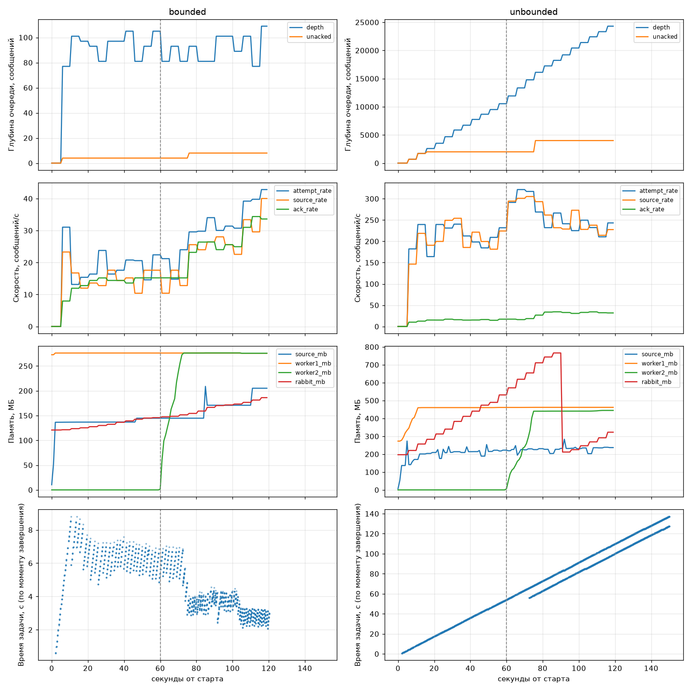

# scoring

Скоринг снимков Kaggriculture через RabbitMQ. Источник и `POST /api/v1/tasks` кладут задачи в ограниченную очередь, воркеры на FastStream считают вероятность победы моделью из MLflow и пишут результат в Postgres. Медленные воркеры сами задают темп источнику, а внешний клиент при перегрузке сразу получает 503.

```
источник (реплеи) ──publish, ждёт confirm──┐
                                           ▼
POST /api/v1/tasks ──publish, ждёт confirm──> tasks: quorum, x-max-length=100, reject-publish
     │ nack → 503                           │ prefetch=4                │ после 3 возвратов
     ▼                                      ▼                           ▼
  Postgres <────── upsert по id ────── воркер ×N                  tasks.dlx → tasks.dlq
                                       модель @champion, 4 потока
```

Признаки и загрузку модели берём из соседнего проекта [`mlflow`](../mlflow/README.md), он подключён path-зависимостью. MLflow поднимается там же (`make up`), в реестре должна быть `kaggriculture-winprob@champion`.

## Запуск

```bash
make install           # зависимости и .env
make up                # RabbitMQ (UI на :15672, guest/guest) и Postgres
make worker            # воркер на :8001
make worker PORT=8002  # второй воркер
make source            # источник по реплеям из REPLAYS, можно LIMIT=1000
make api               # API на :8000
make test
```

```bash
curl -i -X POST localhost:8000/api/v1/tasks -H 'content-type: application/json' -d @docs/observation.json
curl localhost:8000/api/v1/tasks/<id>
```

`POST /api/v1/tasks` заменил синхронный `/process`: отвечает `202` с `Location`, результат потом читается через `GET`.

Код в `src/scoring/`:

- `topology.py` — формат задачи, очередь, DLX, DLQ;
- `worker.py` — подписчик, пул потоков, `/healthz`;
- `source.py` — чтение реплеев и публикация с повтором;
- `api.py` — HTTP;
- `db.py` — таблица и upsert;
- `experiment.py` — эксперимент из конца README.

Источник, воркеры и API — отдельные процессы, связаны только через RabbitMQ. Все параметры в `.env.example`. Длительность inference задаёт `INFERENCE_DELAY_S` (0.2 с).

Модель воркер грузит один раз при создании приложения. Alias превращается в номер версии, грузится эта версия, номер пишется в каждый результат. Так метаданные не разойдутся с весами, если alias переставят во время загрузки.

## Брокер → воркер

`PREFETCH_COUNT=4` и `WORKER_THREADS=4`. aio-pika запускает обработчик на каждое доставленное сообщение, значит prefetch и есть число задач, которые воркер держит одновременно. Параллельно они выполняются в пуле, поэтому prefetch равен размеру пула.

Задача занимает поток примерно на 0.27 с: 0.2 с задержки, около 30 мс на модель и запись в БД. Отсюда пропускная способность воркера 4 / 0.27 ≈ 15 задач/с, в эксперименте вышло 14.7.

Если сделать prefetch больше пула, лишние сообщения будут ждать внутри воркера. Брокер считает их выданными, второй воркер их не получит, растут память и время задачи, а при падении всё это вернётся в очередь. В эксперименте без лимита воркер набрал 2000 таких сообщений: это потолок quorum-очереди для prefetch 0. Его память выросла с 276 до 462 МБ, а остановка заняла 30 с. Если prefetch меньше пула, потоки простаивают.

Цена равенства — небольшой простой, пока поток пишет результат и ждёт следующее сообщение. Это 7–15% пропускной способности по сравнению с неограниченным prefetch. Можно взять пул + 1, но здесь важнее не держать буфер в воркере.

Event loop inference не блокирует: модель и `time.sleep` выполняются в `ThreadPoolExecutor` через `run_in_executor`. Под нагрузкой `/healthz` воркера отвечает за 1–2 мс, это же проверяет тест `test_inference_does_not_block_event_loop`.

`OMP_NUM_THREADS=1` стоит потому, что HistGradientBoosting запускает свои потоки OpenMP, и они конкурируют с пулом: 32 мс на вызов против 16.

## Воркер → источник

У очереди `x-max-length=100` и `x-overflow=reject-publish`, у публикаций включены publisher confirms. Когда очередь полна, брокер отвечает на публикацию `basic.nack`, в источнике это `DeliveryError`.

Получив отказ, источник ждёт и повторяет то же сообщение. Пауза удваивается от 10 мс до 1 с, со случайной частью, и сбрасывается после успеха. Следующее сообщение не отправляется, пока не подтверждено текущее, а реплеи читаются по одной партии. Поэтому задачи не теряются и не копятся в памяти: за 27 тысяч задач память источника не выросла.

Место в очереди освобождается с той скоростью, с какой воркеры подтверждают сообщения, и источник занимает его по мере освобождения. В итоге его скорость сама становится равна суммарной скорости воркеров, и второй воркер ускоряет источник без каких-либо настроек.

Пауза ограничена 1 с: при двух воркерах очередь из 100 задач уходит за 3.5 с, и за время паузы источника она не успеет опустеть.

Лимит quorum-очереди считает только готовые сообщения и пропускает одно сверх лимита. Поэтому в UI бывает до 101 + 4 × число воркеров.

Почему не другие способы:

| Способ | Почему нет |
|---|---|
| смотреть глубину через Management API | статистика обновляется раз в 5 с, между проверкой и публикацией очередь меняется, несколько источников гонятся; nack приходит на каждое сообщение сразу |
| `x-overflow=drop-head` | брокер выбрасывает старые задачи |
| memory alarm и flow control брокера | срабатывают на весь узел и блокируют всех публикаторов, включая API, которому нужно быстро ответить 503 |
| фиксированный rate limit источника | подбирается руками под число воркеров, второй воркер ничего не даст |
| воркер сам сообщает, сколько готов принять | то же, что prefetch и лимит очереди, только с отдельным обратным каналом |
| буфер в источнике | задачи копятся в памяти и теряются при падении |

## Граница системы

Клиента API замедлить нельзя, поэтому API не ждёт места в очереди. Он в одной транзакции вставляет строку `pending`, публикует задачу и ждёт confirm. На `ack` делает коммит и отвечает 202. На `nack` или ошибку брокера откатывает транзакцию и отвечает 503. После 503 в БД ничего не остаётся. Если воркер обработал задачу раньше коммита, его upsert подождёт на первичном ключе.

`Retry-After` — это время, за которое воркеры разберут текущую очередь: `ceil(сообщений × INFERENCE_DELAY_S / (консьюмеров × PREFETCH_COUNT))`, от 1 до 60 с. Если консьюмеров нет, 60 с. Цифры берутся из ответа на `queue.declare` по AMQP. При одном воркере выходит 5 с, при двух 3 с. Оценка снизу: реальное время задачи 0.27 с, а не 0.2.

Это сброс нагрузки, а не противодавление. При противодавлении производитель замедляется и работа не теряется, как у источника. Клиент API вне нашего контура, его замедлить нечем. Поэтому лишнее отбрасывается на входе, клиенту говорят, когда прийти снова, а повторять или нет — решает он сам.

Проверено: 50 параллельных запросов при полной очереди получают `503` и `Retry-After: 5` за 70–95 мс, строк `pending` в БД ноль.

## Ошибки и надёжность

`ack_policy=NACK_ON_ERROR`: ack только после коммита результата, при исключении nack с возвратом в очередь. Если воркер упал до ack, брокер вернёт сообщение сам. Почему не другие политики:

- `ACK_FIRST` теряет задачу при падении воркера;
- `ACK` теряет задачу при ошибке;
- `REJECT_ON_ERROR` (по умолчанию в FastStream) сразу отправляет в DLQ даже временные сбои вроде недоступной БД;
- `MANUAL` даёт то же самое, только руками.

Повторы считает сама quorum-очередь. После `x-delivery-limit=3` возвратов сообщение уходит в `tasks.dlx` и оттуда в `tasks.dlq`. Битое сообщение доставляется четыре раза, потом лежит в DLQ с `x-death.reason = delivery_limit`. Перенос в DLQ идёт со стратегией `at-least-once`, чтобы сообщение не пропало по дороге. DLX объявляют все процессы при старте: если его нет, брокер молча выбросит сообщение.

Идемпотентность держится на первичном ключе: результат пишется через `INSERT … ON CONFLICT (id) DO UPDATE`, повторная доставка обновляет ту же строку. У задач источника `id = uuid5(партия/шаг)`, так что и повторный запуск источника не даст дублей.

По SIGTERM воркер перестаёт брать сообщения и до 30 с ждёт те, что уже в работе (их не больше prefetch), потом закрывает пул и БД. Что брокер успел доставить после этого, без ack вернётся в очередь.

Очереди durable, сообщения persistent, у RabbitMQ в compose фиксирован `hostname`. Без этого пересозданный контейнер не видит очереди из тома. Сообщения переживают `docker compose restart rabbitmq`.

## Тесты

`make test`, нужен Docker.

- `test_worker.py` на TestRabbitBroker: результат записан, повторная доставка не дублирует строку, битое сообщение не даёт результата, inference не блокирует event loop.
- `test_api.py` на TestRabbitBroker: 202 и чтение по `Location`, 404, 422.
- `test_overflow.py` на настоящих RabbitMQ и Postgres из Testcontainers:
  - очередь с лимитом 5 отклоняет публикацию;
  - API отдаёт 503 без `pending`;
  - источник ждёт воркер и в итоге доводит до БД все 30 задач без дублей;
  - битое сообщение попадает в DLQ;
  - при остановке воркер дорабатывает взятые 4 задачи, остальные 4 остаются в очереди.

## Эксперимент

`make experiment`: два прогона по 120 с, второй воркер подключается на 60-й секунде, графики пишутся в `docs/experiment.png`.

- **bounded** — лимит 100, prefetch 4.
- **unbounded** — без лимита очереди и prefetch.

Раз в секунду снимаются:

- глубина очереди и счётчики из Management API;
- память процессов и узла RabbitMQ;
- время задачи по БД, от принятия брокером до записи результата.

Скорость источника считается как принятые брокером сообщения: ack + прирост глубины. Счётчик `publish` включает отклонённые попытки, на графике он отдельно, `attempt_rate`.



| | bounded | unbounded |
|---|---|---|
| глубина очереди, максимум | 109 | 24 310 |
| источник / обработка, 1 воркер, задач/с | 14.8 / 14.7 | 214 / 15.8 |
| источник / обработка, 2 воркера, задач/с | 28.4 / 28.2 | 238 / 33.0 |
| память воркера, МБ | 276 | 462 |
| память RabbitMQ, МБ | 186 | 766 |
| время задачи: медиана / p95 / максимум, с | 4.0 / 7.1 / 8.8 | 82 / 128 / 137 |

С лимитом очередь держится у 100, источник идёт со скоростью воркеров. Второй воркер почти удвоил обработку, источник ускорился вместе с ним. Время задачи упало с 6.5 до 3.5 с: 100 задач в очереди / 28 задач в секунду.

Без лимита источник в 13 раз быстрее воркера, очередь растёт на 200 сообщений в секунду, время задачи растёт вместе с ней и к концу прогона превышает две минуты. Память RabbitMQ растёт с очередью; падение около 90-й секунды — это сброс журнала quorum-очереди на диск. Второй воркер здесь ничего не решает: очередь всё равно растёт, он сразу забирает себе 2000 сообщений, и порядок обработки ломается (вторая линия на нижнем графике).

## Что показать на защите

| Сценарий | Команда | Что видно |
|---|---|---|
| нагрузка | `make worker`, `make source` | в UI у `tasks` Ready около 100, Publish ≈ Ack ≈ 15/с, в логе источника растёт `rejected` |
| второй воркер | `make worker PORT=8002` | Consumers 2, скорость около 28/с |
| меньше лимит | `docker compose exec rabbitmq rabbitmqctl set_policy --apply-to queues limit '^tasks$' '{"max-length":20}'` | очередь держится у 20, скорость та же; поднять выше 100 можно только пересозданием очереди с новым `QUEUE_MAX_LENGTH` |
| другой prefetch | `PREFETCH_COUNT=1 WORKER_THREADS=1 make worker` | Unacked 1 на воркер, около 4 задач/с |
| prefetch больше пула | `PREFETCH_COUNT=50 make worker` | Unacked 50, второму воркеру достаётся меньше |
| остановить воркер | Ctrl+C или `kill -TERM` | `shut down gracefully`, взятые задачи в БД, остальные снова в Ready |
| убить воркер | `kill -KILL` | неподтверждённые вернутся и обработаются ещё раз, строк в БД не прибавится |
| битое сообщение | `make poison` | четыре ошибки валидации в логе, сообщение в `tasks.dlq` |
| 503 | `seq 50 \| xargs -P 25 -I{} curl -s -o /dev/null -w '%{http_code} %header{retry-after}\n' -X POST localhost:8000/api/v1/tasks -H 'content-type: application/json' -d @docs/observation.json` | `503 5`, `pending` в БД нет |
